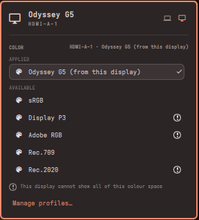

# Omacolor

Per-monitor colour profiles for Omarchy, in one click. Omacolor adds a bar widget whose panel lets
you pick an ICC colour profile for each display: no file editing, no config reload by hand.



- A display picker at the top right (a laptop for the built-in panel, a monitor for the others);
  the panel opens on the focused display.
- The applied profile on top with a ✓, the available ones below; click the applied one again to
  remove it.
- Built-in profiles: one made from the display's own EDID ("from this display"), sRGB,
  Display P3, Adobe RGB, Rec.709, Rec.2020. A warning mark means the profile is wider than the
  display can show.
- Your own `.icc` files in `~/.local/share/icc/` are listed too. A file is checked when you pick it;
  a broken one is refused with a message and nothing changes.
- The choice is remembered per monitor model, so it comes back after a reboot, a replug, a
  suspend or a config reload (the same monitor model shares one choice).
- A display with no saved choice is left alone.
- **Manage profiles…** opens `~/.local/share/icc/` in your file manager.

## Who it is for

- **Wide-gamut screens** (OLED laptops, P3 monitors). Hyprland treats every display as sRGB by
  default, which makes these screens look oversaturated. Pick **Display P3** or the profile made
  from the display to fix that.
- **Anyone with a calibrated or purchased `.icc` profile**: drop it in `~/.local/share/icc/` and
  pick it.

On a screen that is already close to sRGB, most profiles change very little.

> Tested on two near-sRGB displays (a laptop BOE panel and a Samsung Odyssey G5). The wide-gamut
> presets work as profiles, but their effect on a wide-gamut screen has not been seen by the author
> yet. Reports are welcome.

## Install

```bash
omarchy plugin add https://github.com/edneymatias/omacolor --enable
```

Omacolor sits next to the stock Display widget and does not change it.

## Usage

Click the palette icon in the bar, or open the panel from a terminal:

```bash
omarchy-shell shell summon "io.github.edneymatias.omacolor" '{}'
```

Pick a display at the top right, then a profile. Keyboard: `j`/`k` move between the display
picker and the profiles, `h`/`l` change the display, `Enter` applies, `Esc` closes.

To open it with a key, add your own binding in `~/.config/hypr/bindings.lua` with
`{ panel = "io.github.edneymatias.omacolor" }`, the same way Omarchy binds its own panels.

## Configuration

Move the widget in the bar like any other:

```bash
omarchy bar move io.github.edneymatias.omacolor --section right
```

Put your own profiles in `~/.local/share/icc/` (or use **Manage profiles…**). Nothing else needs
configuring.

## Dependencies

The plugin installs nothing. It uses:

| Needs | Package | Used for | If missing |
|---|---|---|---|
| `hyprctl`, Hyprland 0.56 | `hyprland` | applying profiles, reading displays and events | required (Omarchy depends on it) |
| Quickshell (`qs`) | `quickshell` | the shell and this plugin | required (Omarchy depends on it) |
| `python3` | `python` | the helper `bin/omacolor-profile` (EDID, ICC files, validation) | profiles are not generated and nothing is applied; Omarchy does **not** declare this package |
| `xdg-open` | `xdg-utils` | the **Manage profiles…** row | that row does nothing; Omarchy does **not** declare this package |
| `transicc` | `lcms2` | an extra check of your `.icc` files | optional: without it only the file header is checked |

Install a missing one with `sudo pacman -S python xdg-utils lcms2`.

## Privileges

The plugin runs inside the Omarchy shell as your user, unsandboxed, like every Omarchy plugin.
It never uses `sudo` and downloads nothing. It runs these commands: `hyprctl` (read displays,
apply a profile, reload the config when a profile is removed), its own `bin/omacolor-profile`
with `python3`, `mkdir`, and `xdg-open` for **Manage profiles…**. It writes only inside its own
folder (`~/.config/omarchy/plugins/io.github.edneymatias.omacolor/.data/`: the saved choices and
the profiles it generates), creates `~/.local/share/icc/` if it is missing, and never writes to
`monitors.lua` or any other configuration file. It only reads your profiles in
`~/.local/share/icc/`; it never moves, changes or deletes them.

## How it works

A profile is applied with `hyprctl eval 'hl.monitor({ output = "...", icc = "..." })'`. Hyprland
forgets it on a config reload, when a display is plugged and after suspend, so the plugin listens
for `configreloaded` and `monitoraddedv2` and applies the saved choice again about a second later.

Removing a profile uses `hyprctl reload`, because a profile applied at runtime cannot be cleared
any other way; it takes about 0.1 s.

## Removal

Remove it from the Omarchy plugin menu, or:

```bash
omarchy plugin remove io.github.edneymatias.omacolor
```

Everything the plugin created lives in its own folder, so removing the plugin deletes it: the
saved choices and the profiles it generated. Your own profiles in `~/.local/share/icc/` are not
part of the plugin and stay where they are, as do `monitors.lua` and the rest of your
configuration.

A profile that is applied when you remove the plugin stays on screen until the Hyprland config is
reloaded or you log in again. To clear it at once, run `hyprctl reload` after removing the plugin.

## Troubleshooting

Shell errors, including this plugin's `omacolor:` lines:

```bash
qs log -p "$OMARCHY_PATH/shell" --tail 100
```

**The profile list is empty, or the panel takes many seconds to fill it.**
`python3` is probably missing: every helper call then waits 10 s and gives up. Check with
`command -v python3`; install it with `sudo pacman -S python`, then `omarchy-restart-shell`.

**"Manage profiles…" does nothing.**
`xdg-open` is missing (`sudo pacman -S xdg-utils`) or no file manager is set for folders
(`xdg-mime query default inode/directory` prints nothing).

**My `.icc` file is refused with a warning.**
Only RGB display profiles (class `mntr`) are accepted, and the file must be complete. See why with
`bin/omacolor-profile check ~/.local/share/icc/<file>.icc` from the plugin folder. With `lcms2`
installed the check also reads the whole profile, not only its header.

**"This display does not identify itself".**
The display reports no make or model (`hyprctl monitors -j`), as virtual outputs and some adapters
or KVMs do. The plugin keeps choices per make and model, so it cannot keep one for this display.
You can still set `icc = "/path/file.icc"` for it by hand in `~/.config/hypr/monitors.lua`.

**There is no "from this display" profile.**
The display's EDID could not be read or makes no sense (zero or collinear colour coordinates). See
the reason with `bin/omacolor-profile edid-info <port>` (for example `HDMI-A-1`) from the plugin
folder.

**A profile does not come back after a reload, a replug or a suspend.**
Check that the plugin is enabled (`omarchy plugin list | grep omacolor`) and read the shell log.

**The panel keeps showing old behaviour after an update.**
Run `omarchy-restart-shell`.

## Translating

`i18n/en.json` and `i18n/pt-BR.json` ship with the plugin. To add a language, see
[i18n/README.md](i18n/README.md).

## Development and tests

From the repository root:

```bash
omarchy plugin validate .
node --test 'tests/*.test.js'
python3 -I -m unittest discover -s tests -p 'test_*.py'
```

`node` is only needed for the tests.

## License

MIT, see [LICENSE](LICENSE).
